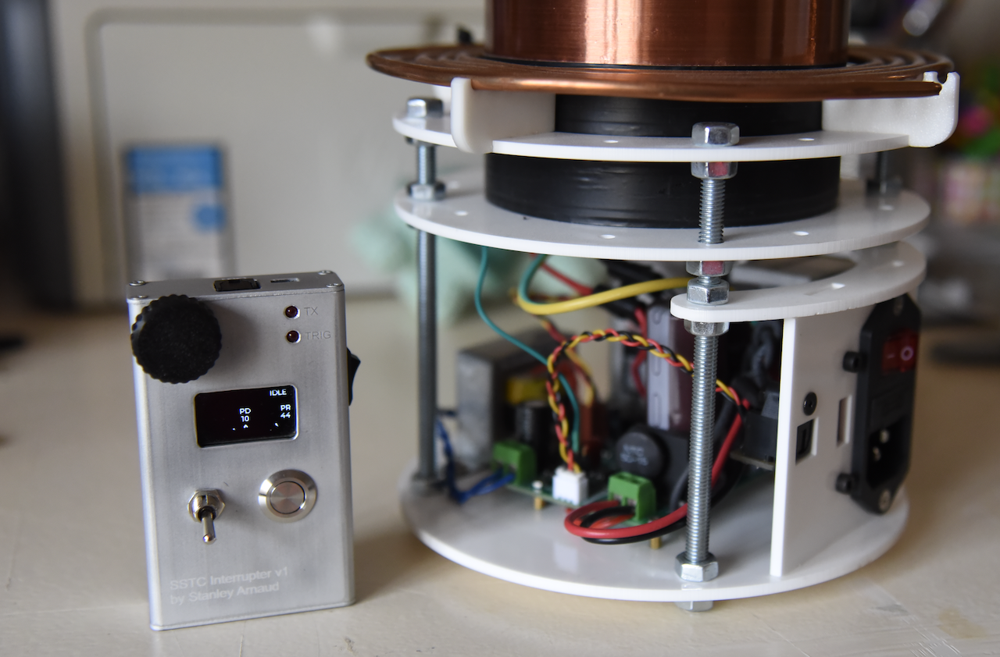
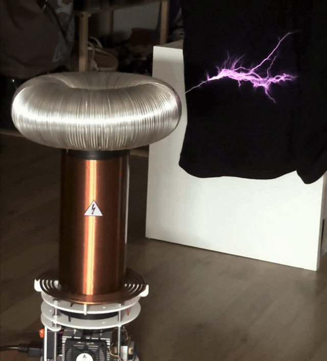

# sstc-interrupter-esp32

**Still in development! Maybe unstable.**

> This project implements a digital interrupter for any Solid State Tesla Coils (SSTC, DRSSTC, ...). The interrupter allows precise control over the arc output using different control modes, making it easy to experiment with pulse timing or MIDI control.

## Features
- **Three Control Modes**
    - Manual: Fully custom PWM output from 0 to 20 kHz, with 1 µs minimum pulse width.
    - USB MIDI: Supports up to 8 simultaneous notes

- **User Interface**
    - SSD1306 64x128 monochrome display
    - Rotary encoder for navigation
    - Two triggers: toggle switch and push button
    - Nice and simple graphical interface

- **Connectivity**
    - USB-C OTG/Serial for MIDI/Programming
    - Toslink SPDIF output

- **Hardware Efficiency**
    - Written entirely in C using ESP-IDF
    - Real-time control via FreeRTOS
    - Optimized for ESP32-S3 hardware
    - Battery powered (200 mAh)

## Demonstration

Playing *Kavinsky - Nighcall*...
